<picture>
  <source media="(prefers-color-scheme: dark)" srcset="assets/banner-hello-dark.svg">
  
</picture>

  <a href="https://www.makescale.agency/"><picture><source media="(prefers-color-scheme: dark)" srcset="assets/btn-website-dark.svg"></picture></a>
  <a href="https://www.linkedin.com/in/ziyahmadov"><picture><source media="(prefers-color-scheme: dark)" srcset="assets/btn-linkedin-dark.svg"></picture></a>
  <a href="https://www.behance.net/ziyaahmadov"><picture><source media="(prefers-color-scheme: dark)" srcset="assets/btn-behance-dark.svg"></picture></a>
  <a href="https://medium.com/@ziyahmadov"><picture><source media="(prefers-color-scheme: dark)" srcset="assets/btn-medium-dark.svg"></picture></a>
  <a href="https://cal.com/ziya-ahmadov-makescale/30min"><picture><source media="(prefers-color-scheme: dark)" srcset="assets/btn-call-dark.svg"></picture></a>
  <a href="mailto:makescaleagency@gmail.com"><picture><source media="(prefers-color-scheme: dark)" srcset="assets/btn-email-dark.svg"></picture></a>

 

#### About

I design digital products around real people: how they think, what they need, and where they get stuck.

I run **make/scale**, a design studio for founders. We help with brand, product, and web design, from the first idea to real growth.

Before design, I trained as a petroleum engineer. That is why I like clear evidence, simple systems, and good data. Today I am studying for an MSc in Human-Computer Interaction at Tallinn University.

#### Right now

- Designing products with founders at [make/scale](https://www.makescale.agency/)
- Studying how people and technology work together at Tallinn University
- Writing short, research-based articles on [Medium](https://medium.com/@ziyahmadov)

#### How I work

- **Watch first.** What people do tells me more than what they say.
- **Clear before pretty.** When a product is easy to understand, people trust it.
- **Test early.** A small test today saves a big mistake later.

#### Focus

Product design · UX research · Interaction design · Accessibility · Human-centered AI

#### Tools

Figma · Miro · Maze · Hotjar · Webflow · Adobe Creative Cloud · HTML & CSS

#### Latest writing

<!-- BLOG-POST-LIST:START -->
- [Comparing assessment systems across top online learning platforms](https://medium.com/@ziyahmadov/comparing-assessment-systems-across-top-online-learning-platforms-9218b317d14c) Apr 2026
- [Comparing Two Payment Flows: Why Some Banking Apps Feel Faster Than Others](https://medium.com/@ziyahmadov/comparing-two-payment-flows-why-some-banking-apps-feel-faster-than-others-de4746c5d74f) Feb 2026
<!-- BLOG-POST-LIST:END -->

 

Have an idea or a role in mind? <a href="https://cal.com/ziya-ahmadov-makescale/30min">Book a 30-minute call</a> or write to <a href="mailto:makescaleagency@gmail.com">makescaleagency@gmail.com</a>.

